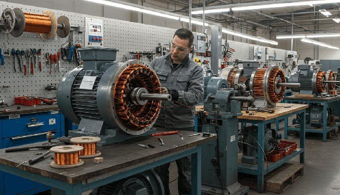
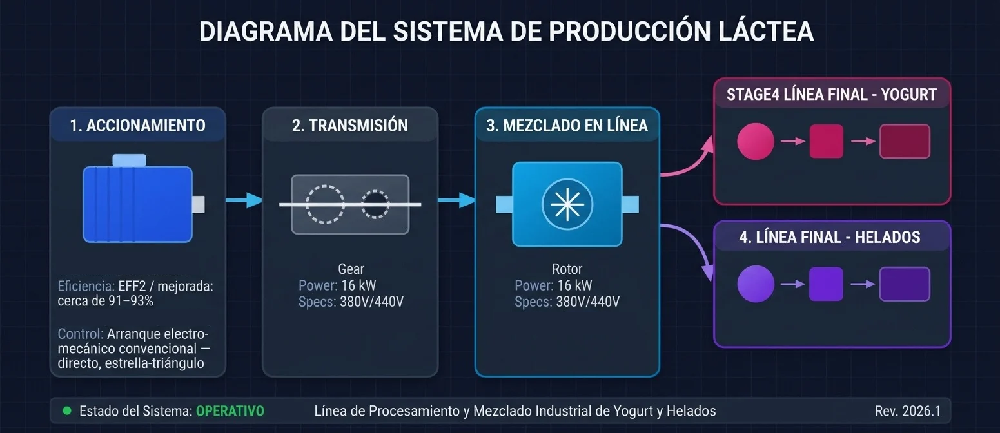

# Recuperación-motor-trifásico-16kW
Diagnóstico y recuperación de un motor trifásico de orign Checoslovaco de 16 kW de potencia nominal y 440/760 V Δ/Y: 440 V en triángulo y 760 V en estrella. que mantenía fuera de servicio una línea de producción.
Caso técnico — Taller de Servicios Electromecánicos de Empresa estatal, Cuba · 1992

## Tres técnicos. Dos rebobinados. El mismo cortocircuito.
En 1992, siendo un joven ayudante de taller, mi primer empleo, decidí intentar resolver una avería que seguía deteniendo un motor crítico de la línea de producción.

## Datos de Chapa del motor Checoslovaco
| Parámetro | Dato |
| :--- | :--- |
| Año | 1980 |
| Motor | Trifásico |
| Potencia | 16 kW |
| Tensión | 380/440V |
| Conexión | Delta-Estrella |
| Eficiencia | EFF2 / mejorada: cerca de 91–93% |
| Tipo de Control | Arranque electromecánico convencional — directo, estrella-triángulo |
| Procedencia | Checoslovaquia |
| Aplicación | Línea de Mezclado |
| Problema | Cortocircuito interno persistente |
| Intervenciones previas | 2 rebobinados |
| Rol | Ayudante de taller |

No era el técnico con más experiencia del taller.
Era el ayudante que decidió investigar el problema antes de aceptar que el motor simplemente “no tenía solución”.

# 01 — El problema
El motor accionaba parte de la línea de mezclado utilizada para la producción de yogurt y helados destinados al consumo de la provincia. Había sido revisado por técnicos y especialistas y rebobinado en dos ocasiones, pero el problema de cortocircuito interno persistía.

# 02 — El punto de inflexión

En lugar de repetir el mismo procedimiento, decidí buscar otra explicación.
Solicité autorización a mis superiores para intentar reparar personalmente el motor y busqué orientación en un ingeniero experimentado ya retirado, quien me facilitó un libro especializado sobre bobinados de motores de procedencia rusa.

**Aprendizaje: cuando el procedimiento conocido no funciona → investigar → consultar una fuente técnica → formular una hipótesis → probarla.**

# 03 — El descubrimiento técnico

[(Datos extraídos del devanado del motor para su rebobinado)](https://github.com/lazarolpro/Recuperacion-motor-trifasico-16kW/blob/main/Devanado-motor-checo-16kw.jpeg)

Durante el estudio encontré una configuración de devanado que correspondía con las características del motor: un sistema denominado en aquella época “paso adelante – paso atrás”, asociado a un devanado fraccionario (Lap Winding).
A partir de esa información reconstruí el esquema del devanado, prestando especial atención a la distribución de las bobinas, el número de vueltas y el sentido de cada grupo de bobinas dentro de las tres fases.

# 04 — De la teoría al taller

(Un visual: Desmontaje → identificación → documentación → cálculo/esquema → rebobinado → montaje → prueba)

(Crear un diagrama vectorial del devanado con:
    • 3 fases
    • grupos de bobinas
    • sentidos de bobinado
    • paso adelante
    • paso atrás
    • conexiones
    • esquema antes/después)

# 05 — La prueba

Llegó el momento de comprobar si la hipótesis funcionaba.

El motor fue montado nuevamente y conectado para realizar la prueba y Funcionó.
El cortocircuito que había mantenido el motor fuera de servicio había sido resuelto.

Según mi recuerdo, el motor continuó funcionando posteriormente sin que volviera a presentarse el problema.

Lo que realmente resolví
No fue solamente un motor.
Fue un problema que ya había resistido varias intervenciones técnicas.
Ante la repetición del mismo resultado, cambié el enfoque: observé el problema, busqué conocimiento especializado, estudié la documentación disponible, reconstruí el esquema y llevé la hipótesis al taller.
Ese proceso marcó uno de los primeros momentos de mi trayectoria en los que comprobé el valor de combinar experiencia práctica, investigación técnica y capacidad para resolver problemas.

# Competencias demostradas

Diagnóstico de averías · Motores trifásicos · Bobinado · Interpretación técnica · Investigación · Resolución de problemas · Trabajo en taller · Iniciativa · Mantenimiento electromecánico

